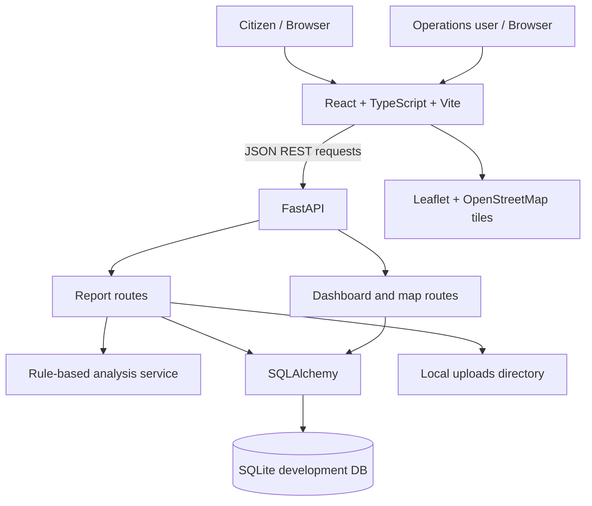

# Architecture

## Trust boundaries
- The browser is untrusted; backend Pydantic schemas validate submitted fields.
- Uploaded images are limited by size and validated by declared type plus file signature. Production deployments still need malware scanning, private object storage, and authorization.
- Rule-based analysis is an explainable fallback, not a trained AI model.
- Administrative status changes are currently a development-only endpoint without authentication. Do not expose this prototype publicly.
- Map markers are citizen reports or explicitly fictional seed data, not verified hazards.
